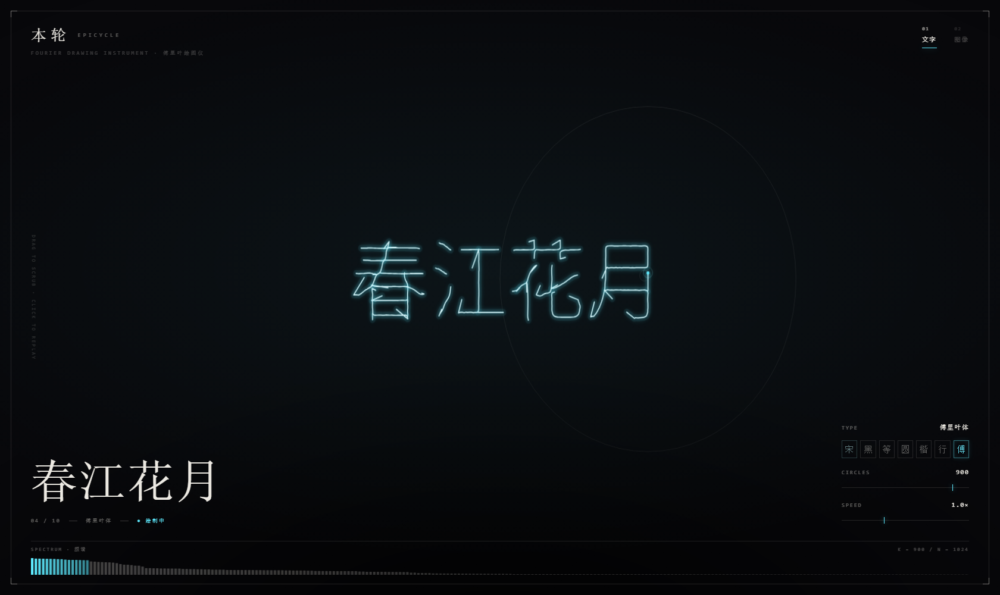
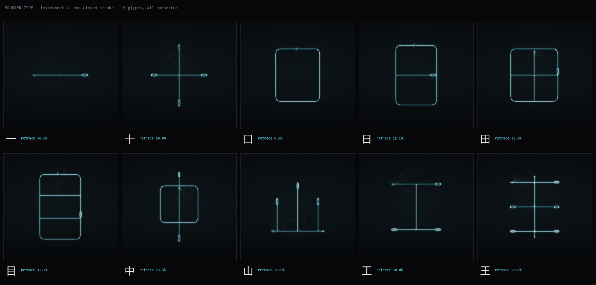

# 本轮 / EPICYCLE

**用傅里叶级数写字的网页仪器。**
输入一句话，它把字形拆成上千个旋转的圆，再一笔一笔画回来。

一个 **零依赖、无需构建** 的静态网页：`index.html` 双击即开。



---

## 这是什么

傅里叶绘图（Fourier drawing）不是什么新东西——把一条闭合曲线拆成一串旋转的圆，是 18 世纪就有的数学。
但这个项目的重点不在算法，在**把绘制过程本身做成一件可看的东西**：

- 圆是一层冷白的幽灵骨架，墨是一条电光青的细线，笔尖是一颗发光的点
- 界面是对仪器面板的模仿：发丝线、极小号全大写的丝印、四角取景器刻线
- 唯一的颜色只给"正在发生的事"

## 功能

| | |
|---|---|
| **文字模式** | 输入 ≤10 个字，实时绘制 |
| **七种字面** | 宋、黑、等、圆、楷、行 —— 以及自制的 **傅里叶体** |
| **两种笔法** | **分笔**：每根笔画独立一串圆，画完一笔抬笔。<br>**一笔**：整字是一条闭合回路（中国邮递员问题），笔从不抬起 |
| **声音** | 可选。三条正弦读的是这个字自己的频谱；底噪跟着笔速走。默认静音 |
| **导出** | **PNG**（当前墨迹 + 背景光，无界面）· **SVG**（真实矢量路径）· **REC**（一个完整循环的 WebM，声音开着会一起录进去） |
| **参数** | 圆的数量 60–1024、速度 0.3×–2.4× |
| **交互** | 点击重播 · 水平拖拽擦洗时间 · 底部频谱条实时联动 |

### 傅里叶体（Fourier Type）

不是字体文件，是一份**骨架数据**：每个字就是一组有序的折线，坐标在 1000 单位的 em 方框里。

- 没有栅格化、没有细化、没有碎枝——结构上就不可能有那些"小短横"
- 不依赖你电脑上装了什么字体，跨系统完全一致
- 内置 558 个常用字；表外的字回落到运行时骨架化

### 一笔模式与回锋环

「永」的骨架是一棵树。树的欧拉回路必须每条边走两遍，所以**回墨率锁死在 50%**——这是拓扑决定的，画得再好也没用（[实验记录](research/FOURIER-TYPE.md)）。

一笔模式因此只支持**天然有环的 10 个几何字**（口、日、田、目、中、山、工、王、十、一）。
在每个 180° 折返的笔尖，程序会插入一个**回锋环**——把级数无法表示的尖点，变成毛笔收笔时那个可见的折返动作。



### 声音

不是音效，是这台仪器的呼吸。默认静音，点「开声」才响。

- **本轮即和弦**：取 |c_k| 最大的三个非直流分量，按振幅排名映射到 A 小调五声音阶。
  同一个字永远是同一个和弦——可以预期，才像乐器。
- **底噪即笔触**：一条 2.6kHz 带通白噪声，增益跟着笔尖速度走。笔快则响，笔停则息。
- **收笔**：一轮画完时八度上浮、混响尾 1.8 秒，和画面一起溶解。
- 第一次点「开声」才创建 AudioContext（浏览器要求用户手势），保证不会突然出声。

## 快速开始

```bash
# 方式一：直接打开
双击 index.html

# 方式二：起一个静态服务器（推荐，行为与线上一致）
python -m http.server 8000
# 然后访问 http://localhost:8000
```

无 npm、无构建、无依赖。

## 部署到 GitHub Pages

```bash
git init
git add .
git commit -m "init"
git branch -M main
git remote add origin git@github.com:<你的用户名>/<仓库名>.git
git push -u origin main
```

然后到仓库 **Settings → Pages**：

- **Source**: `Deploy from a branch`
- **Branch**: `main` / `/(root)`
- 保存，一两分钟后访问 `https://<你的用户名>.github.io/<仓库名>/`

仓库里已经有 `.nojekyll`，避免 Jekyll 处理静态资源。

## 目录

```
index.html            页面
js/geom.js            文字 → 骨架 → 折线（栅格化、细化、剪枝、追踪、圆角）
js/fourier.js         DFT、按 |c_k| 截断、帧表预计算
js/ink.js             双画布渲染：持久墨层 + 每帧圆层
js/app.js             状态机、交互、频谱
data/fourier-font.js  傅里叶体：558 字的骨架数据
data/one-stroke.js    一笔模式：10 个字的单闭合回路
research/             设计文档与实验
tools/                傅里叶体生成器（离屏栅格化 → 骨架 → JSON）
mockup/               最早的视觉小样（心形曲线，纯 DFT 演示）
PLAN.md               最初的方案
```

## 设计文档

- [傅里叶体 · 设计纲领](research/FOURIER-TYPE.md) —— 四条定律、七次实验、每一次都推翻了一点我自己的结论
- [字体 × 傅里叶](research/TYPEFACE.md) —— 12 种字体的骨架对照，小短横到底是怎么来的

## 已知未完成

- 图像模式（照片 → 简笔画 → 绘制）：界面留了位置，尚未实现
- 一笔模式只有 10 个字
- 傅里叶体只有 558 字，表外回落较慢

## 许可

代码尚未选定许可证。字体数据由 Noto Sans SC（SIL OFL）派生——如果二次分发，请保留 OFL 的相关要求。
